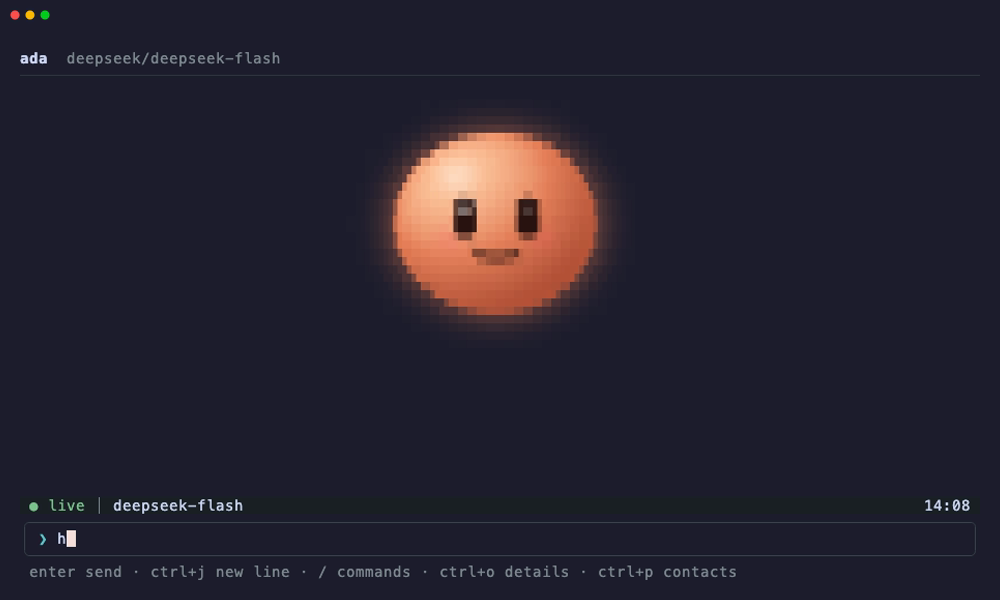
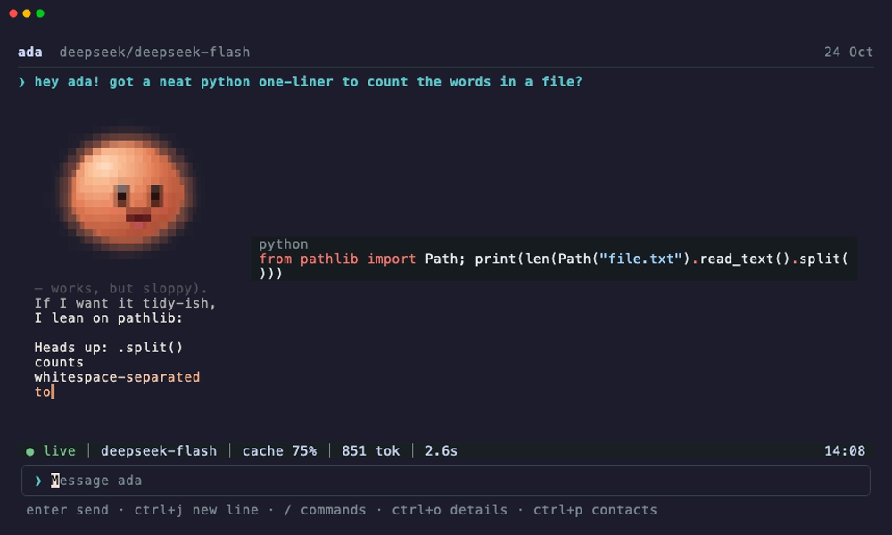
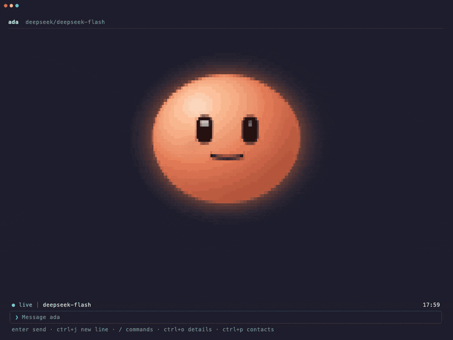
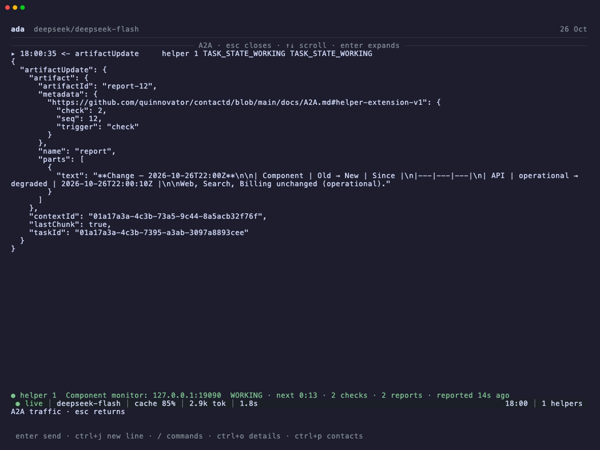
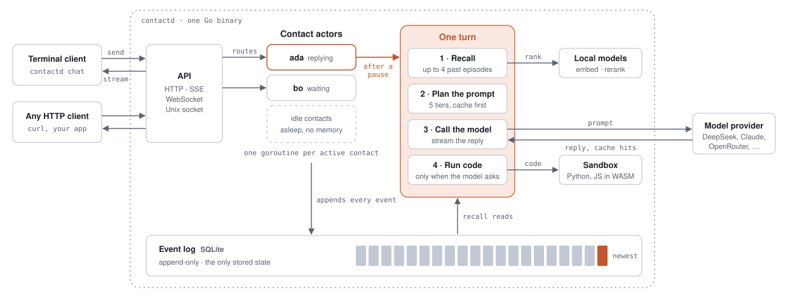
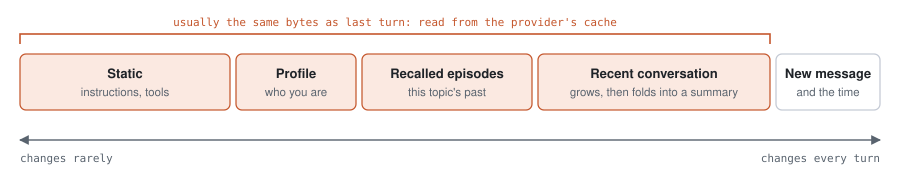

# contactd

<p align="center">
  
</p>

One Go binary, backed by SQLite and two small local ONNX models, that lets a client talk to an AI contact the way it would talk to a person. There is one continuous relationship per contact. A client sends messages to a contact ID; it never creates, picks or names a thread.

Threads, prompt-cache layout and the REPL environment are not stored objects. Each turn derives them just in time from one append-only event log:

- **JIT threads.** Past conversations are segmented into episodes as they happen. Each turn recalls the few that matter, with a local embedder and cross-encoder reranker, and often recalls none.
- **JIT cache.** Every prompt is laid out in five tiers, from least to most volatile, so most turns reuse the provider's cached prefix. The planner predicts the cache hit and checks it against what the provider reports.
- **JIT environments.** A Python or JavaScript sandbox exists only when the model runs code, in-process under WebAssembly, with the contact's files kept between days.

It also behaves like a person on the other end: it waits for you to finish a burst of messages, and a message sent mid-reply interrupts it. Idle contacts cost no memory and no goroutines.

> **Status:** early and single-node. The API has no authentication of its own; see [Security](#security).

## Quick start

You need [mise](https://mise.jdx.dev) and a C compiler for SQLite (on macOS, `xcode-select --install`; on Debian or Ubuntu, `build-essential`).

**1. Get the code and its tools.**

```sh
git clone https://github.com/quinnovator/contactd && cd contactd
mise install    # Go and the other tools, at pinned versions
```

**2. Give it a model.** Export a key for any [supported provider](#model-providers):

```sh
export DEEPSEEK_API_KEY=sk-...    # or ANTHROPIC_API_KEY, OPENROUTER_API_KEY, ...
```

Skip this step and the replies are scripted: enough to see everything work, though Ada mostly says your message back to you.

**3. Say hi.**

```sh
mise run try
```

This builds contactd, starts a server in the background and opens a chat with Ada. Type a message and press `enter`.

<p align="center">
  
</p>

Ada says each reply aloud, the words appearing as they're spoken, and a small synthesised voice babbles along (`mise run try -- -mute` silences it). Code and pictures in a reply are shown beside the avatar. `ctrl+c` quits and stops the server. The conversation is kept in `./data`, so running `mise run try` again picks up where you left off.

No avatar, just a plain thread? Type `/avatar` in the chat to see why. In tmux before 3.4, mosh or screen the client can't tell your background colour; `mise run try -- -theme=dark` (or `light`) tells it.

### Over HTTP

While `mise run try` is open, the same server answers on `localhost:8080`:

```sh
curl -s -XPOST localhost:8080/v1/contacts \
  -d '{"agent":{"system":"You are Bo, a terse code reviewer."},"name":"bo"}'
# {"id":2}   <- Ada is 1

curl -sN localhost:8080/v1/contacts/2/stream &          # SSE: typing, text deltas, tool activity, the committed reply
curl -s -XPOST localhost:8080/v1/contacts/2/messages -d '{"text":"hey, are you around?"}'
# {"seq":2}   <- 202 once the message is durable; seq 1 is the visit's session-start notice
```

[docs/API.md](docs/API.md) has the rest.

## Running it for real

`mise run try` is a server with lexical recall and no code-running tools. Real recall needs ONNX Runtime and the two models, and code-running tools need the WASM runtimes. Each is fetched at a pinned version and verified by checksum:

```sh
mise run deps:native    # libonnxruntime + libtokenizers.a into third_party/lib
mise run deps:wasm      # CPython 3.12 and QuickJS WASI builds into third_party/wasm
mise run models:fetch   # export + int8-quantize bge-small-en-v1.5 and ms-marco-MiniLM-L6-v2 into models/
mise run build          # bin/contactd, built with -tags ORT

DEEPSEEK_API_KEY=... GOMEMLIMIT=3GiB bin/contactd \
  -data-dir=./data -models-dir=./models -wasm-dir=./third_party/wasm
```

Or as a container, with one volume at `/data`:

```sh
mise run models:fetch
docker build -f deploy/Dockerfile -t contactd .
docker run -p 8080:8080 -v contactd-data:/data -e DEEPSEEK_API_KEY -e GOMEMLIMIT=3GiB contactd
```

`GOMEMLIMIT` is not cgroup-aware: set it to the container's memory limit minus room for ONNX Runtime's native memory. It is supported on linux/amd64, linux/arm64 and macOS on Apple Silicon; Windows has not been tried.

## The terminal client

`contactd chat` is a terminal client in the same binary. It finds a local server through the Unix socket in the data directory.

<p align="center">
  
</p>

```sh
contactd chat                  # pick a contact from the list
contactd chat ada              # open the conversation with ada
contactd chat ada "question"   # send one message, print the reply, exit
git diff | contactd chat ada - # the same, with the message read from stdin
```

`enter` sends, `ctrl+j` starts a new line, `esc` stops the reply, `/help` lists the commands. Where the terminal can draw one, an animated avatar speaks the replies (`-avatar=off` for a plain thread). The client shows pictures a tool saved, has a configurable status line, and can be extended with sandboxed WebAssembly [mods](docs/MODS.md). [docs/CLIENT.md](docs/CLIENT.md) covers all of it.

## Helpers over A2A

A contact can hand a standing job to a helper: watch this page every 30 seconds for the next half hour, and speak up only when something changes. Give the contact `agent.helpers: true` and it can start, message, stop and list helpers. Each helper is a contact of its own behind one [A2A 1.0](https://a2a-protocol.org) task, and the two talk over real HTTP, even within one process: the brief goes out as `SendMessage` and reports come back as push notifications. A report becomes a notice in the requester's log. It waits for a reply in progress, never interrupts one, and a check that finds nothing new says nothing.

With a provider key in the environment:

```sh
mise run demo:a2a
```

This starts a small status page on `localhost:9090` and a server with helpers turned on, and opens a chat with Ada. Ask her to watch `http://127.0.0.1:9090` every 30 seconds, then break something from another terminal:

```sh
curl -XPOST 'localhost:9090/set?component=API&state=degraded'
```

The helper's next check finds it, and Ada tells you:

<p align="center">
  
</p>

Each helper gets a card beside the avatar, with its state, a countdown to its next check, and an arrow whenever a message crosses the wire. `/a2a` lists the exchanges themselves, and `enter` opens one as JSON, credentials redacted. `/helper N` follows a helper's own log, read-only.

<p align="center">
  
</p>

[docs/A2A.md](docs/A2A.md) covers authentication, the helper extension, the task lifecycle, push delivery and what survives a restart.

## Model providers

DeepSeek, Anthropic, OpenRouter, OpenCode Go, Ollama Cloud, and any OpenAI-compatible server (vLLM, SGLang, …). Every provider whose key is in the environment is available; `-llm` picks the default and each contact can name its own route. Each route declares how its cache works, which reasoning efforts it takes and whether reasoning is sent back, and `contactd probe` checks those claims against the live endpoint. See [docs/PROVIDERS.md](docs/PROVIDERS.md).

| `-llm` | Credentials |
| --- | --- |
| `deepseek` | `DEEPSEEK_API_KEY` |
| `anthropic` | `ANTHROPIC_API_KEY` |
| `openrouter` | `OPENROUTER_API_KEY` |
| `opencode` | `OPENCODE_API_KEY` |
| `ollama` | `OLLAMA_API_KEY` |
| `openai` | `OPENAI_API_KEY` and/or `-openai-base-urls`, plus `-openai-models` |
| `fake` | none |

## Configuration

Every setting is a flag and an environment variable (`CONTACTD_` + the flag name in upper snake case); flags win. `contactd -h` lists them all. The ones that matter first:

| Flag | Default | Notes |
| --- | --- | --- |
| `-addr` | `:8080` | The TCP address of the API |
| `-data-dir` | `/data` | SQLite, the contacts' files and the Unix socket |
| `-llm`, `-model` | first configured provider, its default model | The default route |
| `-effort`, `-max-tokens` | none | Defaults for agents that set none |
| `-summary-provider`, `-summary-model` | the default route | Where lazy episode summaries are written; point it at something small |
| `-infer` | `ort` | `fake` swaps in a bag-of-words embedder and lexical reranker |
| `-models-dir`, `-wasm-dir` | `/models`, `/wasm` | The ONNX models and the WASM runtimes; an empty `-wasm-dir` turns tier-0 tools off |
| `-sandbox-url` | none | A tier-1 snapshot-sandbox service, for heavier tools |
| `-sync-full` | off | `synchronous=FULL`: never lose an acknowledged message on power loss |
| `-max-hydrated` | derived | Contacts held in memory, from `GOMEMLIMIT` |
| `-tau`, `-gap`, `-theta`, `-delta`, `-tail-budget` | tuned defaults | Recall and compaction; tune with `cmd/replay` before changing them |
| `-diagnostics` | off | Serve `/debug/plans` for `ctxtop`; exposes full prompts |

## How it works

<picture>
  <source media="(prefers-color-scheme: dark)" srcset="docs/images/architecture-dark.svg">
  
</picture>

The event log is the only stored state. Each contact that is talking has one actor goroutine that owns it and is its only writer; an idle contact holds no memory. A turn starts once the person pauses, embeds the new message and recalls up to four past episodes. It then plans the prompt, streams the model's reply, and leases a sandbox only if the model runs code. Recall, the code sandbox and the log all run in-process; only the model provider, and a remote sandbox if you configure one, are outside the binary.

The prompt is laid out in five tiers, from the part that changes least to the part that changes every turn:

<picture>
  <source media="(prefers-color-scheme: dark)" srcset="docs/images/prompt-tiers-dark.svg">
  
</picture>

Providers cache prompts by matching the opening bytes exactly, so each tier is hashed and the planner predicts the cache hit before the call. The recent conversation grows and is folded into a checkpoint in steps, never as a sliding window, so the cached prefix survives most turns. In simulation that gives 87% of input tokens cached on warm turns, against 55% for a sliding window.

[docs/ARCHITECTURE.md](docs/ARCHITECTURE.md) explains each piece, the invariants it keeps, and what was measured.

## Documentation

| | |
| --- | --- |
| [docs/ARCHITECTURE.md](docs/ARCHITECTURE.md) | How it is built, and why; measurements |
| [docs/API.md](docs/API.md) | Endpoints, the stream protocol, agent configs, tools and sub-agents |
| [docs/PROVIDERS.md](docs/PROVIDERS.md) | Model providers, their capabilities, and probing them |
| [docs/CLIENT.md](docs/CLIENT.md) | The terminal client |
| [docs/A2A.md](docs/A2A.md) | Helpers: the A2A protocol surface, delivery and restarts |
| [docs/MODS.md](docs/MODS.md) | Writing a mod for the terminal client |
| [CONTRIBUTING.md](CONTRIBUTING.md) | Development setup, the diagnostics viewer, tests and code patterns |

## Development

```sh
mise run test     # race-enabled unit tests; no API key or models needed
mise run lint     # formatting, linters, SQL style
mise run dev      # server here, chat and the ctxtop diagnostics viewer in new windows
mise run ci       # every CI gate
```

See [CONTRIBUTING.md](CONTRIBUTING.md).

## Security

- **The API is not authenticated.** The TCP address is meant for a trusted network, and the Unix socket (mode `0600`) for the user who runs the server. Put an authenticating proxy in front of it before exposing it further.
- **Tools run model-written code.** Tier 0 runs it under wazero with no network and a filesystem confined to the contact's directory, with memory and time limits. Tier 1 is only as isolated as the sandbox service you point it at.
- **Diagnostics expose prompts.** `-diagnostics` serves full prompt and tool contents over the same access as the API.
- **The terminal client never passes outside text to the terminal raw.** Escape sequences in replies, tool output, names and mods are stripped.

Please report vulnerabilities privately through GitHub's [security advisories](https://github.com/quinnovator/contactd/security/advisories/new) rather than in a public issue.

## License

contactd is licensed under the [Apache License 2.0](LICENSE).

The fetch scripts and the container image include third-party components under their own licenses:

| Component | Used for | License |
| --- | --- | --- |
| [ONNX Runtime](https://github.com/microsoft/onnxruntime) 1.24.1 | Running the local models | MIT |
| [daulet/tokenizers](https://github.com/daulet/tokenizers) 1.26.0 (Hugging Face tokenizers) | Tokenizing for the local models | MIT (Apache-2.0 upstream) |
| [BAAI/bge-small-en-v1.5](https://huggingface.co/BAAI/bge-small-en-v1.5) | Embedder | MIT |
| [cross-encoder/ms-marco-MiniLM-L6-v2](https://huggingface.co/cross-encoder/ms-marco-MiniLM-L6-v2) | Reranker | Apache-2.0 |
| [CPython](https://github.com/brettcannon/cpython-wasi-build) 3.12 for WASI | Tier-0 Python | PSF License |
| [QuickJS-ng](https://github.com/quickjs-ng/quickjs) 0.17.0 | Tier-0 JavaScript | MIT |

Go dependencies are listed in `go.mod`, each under its own license.
